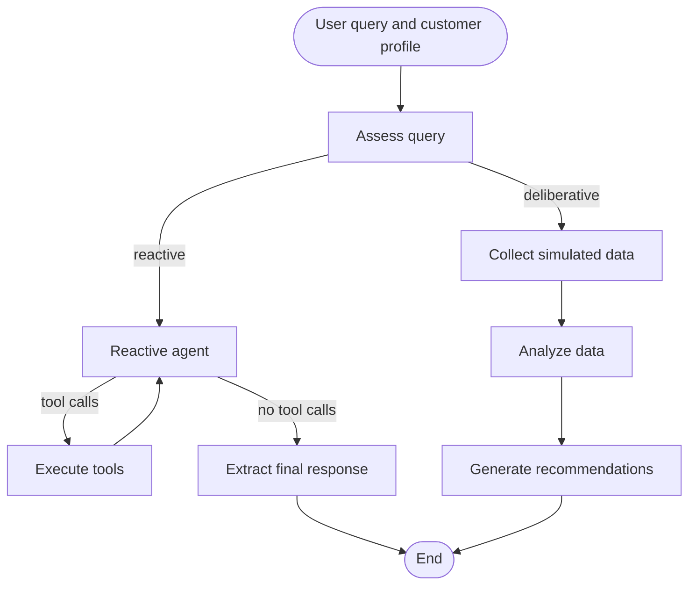

# Hybrid Wealth Advisor with LangGraph

This example implements a wealth management AI assistant with two processing paths: a reactive agent that can call tools and a deliberative pipeline that collects simulated data, analyzes it, and generates recommendations. An LLM assessment chooses the path for each query.

The example demonstrates agent orchestration. Market quotes and news are hard-coded, and the deliberative pipeline generates simulated data. Its responses are not based on a live market feed.

## Files

| File | Purpose |
| --- | --- |
| `hybrid_wealth_advisor_langgraph.py` | Prompts, tools, customer profiles, graph, and interactive command-line interface |
| `requirements.txt` | Pinned LangChain and LangGraph dependencies |

## Setup

Run the following commands from the repository root using the existing `zhihullm` environment:

```bash
python -m pip install -r example_project/wealth_advisor_langgraph/requirements.txt
```

### API key and model

Set the API key in the terminal before running:

```bash
export DASHSCOPE_API_KEY='your-dashscope-api-key'
```

The current client configuration is:

```python
llm = ChatTongyi(model_name="qwen3.8-max", dashscope_api_key=DASHSCOPE_API_KEY)
```

## Run

From the repository root, with `zhihullm` activated:

```bash
python handson_project/wealth_advisor_langgraph/hybrid_wealth_advisor_langgraph.py
```

1. Choose a sample query from `1` to `6`, or enter `0` to provide your own.
2. Choose customer `1` (Balanced) or `2` (Aggressive).
3. Read the printed graph, debug messages, selected processing mode, final response, and elapsed time.

The program handles one query per run. Example queries include asking about the Shanghai Composite Index, portfolio stock allocation, ETFs, retirement planning, or a ten-year education fund.

## Workflow



`assess_query()` classifies the query as `emergency`, `informational`, or `analytical`, and selects `reactive` or `deliberative` processing. Routing depends on `processing_mode`, not directly on `query_type`. Missing or unsupported classification values fall back to `emergency` and `reactive`; malformed JSON is not handled by that fallback.

The reactive path invokes the tool-enabled LLM and loops through `ToolNode` when it requests tools. The deliberative path performs three sequential LLM calls for data collection, analysis, and recommendations after the initial assessment. Both paths use the same configured model.

## Tools and data

| Tool | Current implementation |
| --- | --- |
| `query_shanghai_index()` | Returns fixed values: index `3125.62`, change `6.32`, percentage change `0.20%` |
| `query_portfolio_allocation(asset_type)` | Looks up a fixed allocation dictionary using an exact asset name |
| `query_market_news()` | Returns three fixed sample headlines |

Accepted allocation keys are `Stocks`, `Bonds`, `Cash`, and `Alternative investments`. The lookup is case-sensitive.

Although some tool descriptions and prompts mention real-time data, none of these tools fetches live information. The data collection prompt explicitly asks the LLM to generate plausible simulated data; suggested sources are not actually queried.

## Sample customer profiles

| Property | `customer1` | `customer2` |
| --- | --- | --- |
| Customer ID | `C10012345` | `C10067890` |
| Risk tolerance | Balanced | Aggressive |
| Investment horizon | Medium-term | Long-term |
| Portfolio value | 1,500,000 | 3,000,000 |
| Stocks | 40% | 65% |
| Bonds | 30% | 15% |
| Cash | 10% | 5% |
| Alternative investments | 20% | 15% |
| Goals | Retirement and children's education | Wealth growth and diversification |

## Use from Python

With this directory on the Python import path and the API key configured:

```python
from hybrid_wealth_advisor_langgraph import run_wealth_advisor

result = run_wealth_advisor(
    "Considering my retirement goals, assess my investment strategy.",
    customer_id="customer1",
)

print(result["processing_mode"])
print(result["final_response"])
```

`customer_id` is a key such as `customer1`, not the profile's `C10012345` identifier. Unknown keys fall back to `customer1`.

The function returns the final graph state, including the query, customer profile, classification, processing mode, messages, and final response. The deliberative path also fills `market_data` and `analysis_results`. Each invocation builds a new graph and starts with an empty message history; no persistent conversation memory or output files are configured.

## Customization

- Edit `SAMPLE_CUSTOMER_PROFILES` to change the example customers.
- Edit the four prompt constants to adjust assessment, collection, analysis, and response behavior.
- Replace the mock tool implementations with actual data sources and make portfolio lookup use the selected profile.
- Add tools to the `tools` list so both the LLM binding and `ToolNode` receive them.
